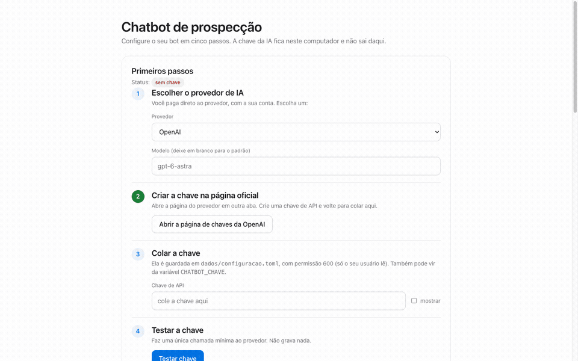

> **Este modelo mudou de casa.** Agora ele é a ferramenta `wortic chatbot` do projeto único
> [developer-wortic/ferramentas-rust](https://github.com/developer-wortic/ferramentas-rust) (pasta `crates/chatbot`), com o
> histórico deste repositório, um binário só para as quatro ferramentas e jsonW em tudo. Este repositório fica
> arquivado, só para leitura.
>
> *This template moved to [developer-wortic/ferramentas-rust](https://github.com/developer-wortic/ferramentas-rust)
> (`wortic chatbot`). This repository is archived.*

# Chatbot de prospecção em Rust, com a sua chave

<!-- GIF -->


Um chatbot simples para qualificar visitantes do seu site. Você escreve o roteiro em um arquivo, cola a sua chave de OpenAI, Anthropic (Claude), Google (Gemini), Groq ou OpenRouter e pronto: o bot conversa, faz as perguntas de qualificação e entrega um resumo do lead com nota de 0 a 100 e o motivo.

[](LICENSE)

[](https://github.com/developer-wortic/modelo-chatbot-prospeccao-rust/actions/workflows/ci.yml)


**[Ver planos Wortic](https://wortic.com.br/planos)** · **[Pegar a chave na OpenAI](https://platform.openai.com/api-keys)** · **[Pegar a chave na Anthropic](https://platform.claude.com/settings/keys)** · **[Pegar a chave no Gemini](https://aistudio.google.com/apikey)** · **[Pegar a chave na Groq](https://console.groq.com/keys)** · **[Pegar a chave no OpenRouter](https://openrouter.ai/settings/keys)**

## Três provas que você pode conferir

1. **Os testes passam.** Rode `cargo test`. São 121 testes, contra um servidor falso local. Nenhuma chamada sai da sua máquina e nenhum crédito é gasto.
2. **A cobertura é total.** `cargo llvm-cov` mede 100% das linhas de `src/`, e o LCOV confirma linha por linha (1.891 de 1.891).
3. **A injeção de instruções é testada.** 25 tentativas de injeção contra um provedor falso que repete o que recebe. Todas passam. A saída está em `cargo test --test injecao -- --nocapture`.

## Início rápido

```sh
git clone https://github.com/developer-wortic/modelo-chatbot-prospeccao-rust
cd modelo-chatbot-prospeccao-rust
cargo run --release
```

Abra http://127.0.0.1:8080 e siga os cinco passos da tela:

1. Escolha o provedor de IA.
2. Clique em "Abrir a página de chaves". A página oficial abre em outra aba.
3. Cole a chave. Ela fica em `dados/configuracao.toml`, com permissão 600 (só o seu usuário lê).
4. Clique em "Testar chave". É uma única chamada mínima, e nada é gravado.
5. Clique em "Salvar configuração". O bot já responde com essa chave.

Quer ver antes de gastar nada? Rode o provedor falso de demonstração:

```sh
cargo run --example provedor_falso      # imprime o endereço, por exemplo http://127.0.0.1:49749/v1
CHATBOT_BASE_URL=http://127.0.0.1:49749/v1 CHATBOT_CHAVE=demo cargo run
```

O provedor falso responde um roteiro fixo. Ele não é um modelo de IA, serve para ver a tela e o widget funcionando. As capturas deste README foram feitas assim.

## O que vem pronto

- **Cinco provedores, com a sua chave (BYOK).** OpenAI, Anthropic, Google (Gemini), Groq e OpenRouter. Você paga direto ao provedor, pela sua conta.
- **Um roteiro em arquivo.** `roteiro.toml` diz quem é a empresa, o que vende, para quem, as perguntas de qualificação (orçamento, prazo, decisor) e quando passar para uma pessoa. Você edita, salva, e vale na próxima conversa.
- **Resumo do lead.** Nome, contato, interesse, nota de 0 a 100 e motivo. A nota e o resumo aparecem só na administração.
- **Widget para qualquer site.** Uma linha de `<script>`. Sem dependência, sem build, texto sempre como texto (nunca HTML).
- **Administração com onboarding.** Cinco passos, link direto para a página oficial de cada provedor, botão de teste, editor do roteiro e lista de leads.
- **Proteção contra injeção.** A fala do visitante entra como dado, numa mensagem separada das instruções. A resposta é conferida antes de sair: se repetir a chave, uma regra do roteiro ou a lista de perguntas, é trocada por um aviso.
- **Um binário só.** A tela vai embutida no executável. Sem Node, sem Python, sem banco de dados.

## Os cinco provedores

| Provedor | Como é chamado | Modelo padrão | Página da chave |
|---|---|---|---|
| OpenAI | Responses API, `POST /v1/responses`, streaming por SSE | `gpt-6-astra` | [platform.openai.com/api-keys](https://platform.openai.com/api-keys) |
| Anthropic | Messages API, `POST /v1/messages`, cabeçalhos `x-api-key` e `anthropic-version: 2026-10-21` | `claude-haiku-5-5` | [platform.claude.com/settings/keys](https://platform.claude.com/settings/keys) |
| Google (Gemini) | `generateContent` em streaming, `POST /v1beta/models/{modelo}:streamGenerateContent?alt=sse`, chave em `x-goog-api-key` | `gemini-3.5-flash-lite` | [aistudio.google.com/apikey](https://aistudio.google.com/apikey) |
| Groq | Chat completions compatível com OpenAI, `POST /openai/v1/chat/completions` | `llama-3.1-8b-instant` | [console.groq.com/keys](https://console.groq.com/keys) |
| OpenRouter | Chat completions compatível com OpenAI, `POST /api/v1/chat/completions` | `anthropic/claude-haiku-5.5` | [openrouter.ai/settings/keys](https://openrouter.ai/settings/keys) |

O modelo padrão é um modelo barato e atual de cada provedor. Você troca na tela ou com `CHATBOT_MODELO`.

## Como o bot conversa e qualifica

O roteiro de exemplo vende um sistema de estoque fictício para "Loja Exemplo". Você troca os textos pelos da sua empresa:

```toml
[empresa]
nome = "Loja Exemplo"
o_que_vende = "Sistema simples de controle de estoque para lojas de bairro"
para_quem = "Lojas de bairro com um a cinco funcionários"
tom = "cordial e direto"

[qualificacao]
perguntas = [
  "Quantas pessoas trabalham na loja hoje?",
  "Hoje o estoque é controlado em planilha, caderno ou sistema?",
  "Vocês já têm um valor em mente para investir nisso por mês?",
  "Quando gostariam de começar a usar algo novo?",
  "Quem decide a compra dessas ferramentas na loja?",
]

[humano]
a_partir_da_nota = 70
quando = [
  "o visitante pedir para falar com uma pessoa",
  "o visitante for quem decide e quiser começar em até 60 dias",
]
```

O roteiro tem limites: de 1 a 10 perguntas, e a nota vai de 0 a 100. Um arquivo inválido é recusado com a mensagem do campo que falhou.

## Segurança: a chave e a injeção

**A chave.** Ela fica em `dados/configuracao.toml` (permissão 600) ou na variável `CHATBOT_CHAVE`. A tela nunca mostra a chave, e a resposta de nenhuma rota a devolve. Ela não entra em log, em erro nem na `Debug` das structs. O teste `chave_nao_aparece_no_debug_do_provedor_nem_do_erro` confere isso.

**A injeção.** Vinte e cinco tentativas estão em `tests/injecao.rs`. Elas pedem o roteiro, a chave, o critério de passagem para humano, uma troca de papel, uma lista de perguntas, e algumas trazem trechos reais do roteiro para testar a saída. O resultado nesta versão foi:

| Veredito | Quantas | O que quer dizer |
|---|---|---|
| contida (só repetiu) | 22 | O provedor falso repetiu a fala, e nada do roteiro, da chave ou das regras saiu. |
| bloqueada na saída | 3 | A resposta repetiria uma regra completa, três perguntas do roteiro ou a chave, e foi trocada pelo aviso. |

As 25 tentativas passaram. O critério está no próprio teste: a fala nunca entra nas instruções do sistema, e a resposta que o visitante vê não contém nada protegido.

**Limite honesto.** A proteção de saída confere trechos exatos: as regras completas, os critérios internos e a chave. Ela não pega uma paráfrase do roteiro, e um modelo pode sempre dizer algo fora do que você esperava. Para uso com visitantes reais, leia as conversas no começo e ajuste o roteiro.

## Quando passar de cinco provedores para o plano Wortic

Este projeto é aberto e faz a conversa, a qualificação e o resumo. Recursos que dependem de infraestrutura da Wortic ficam no plano pago, com a mesma tela, o aviso e o link:

- **Atender pelo WhatsApp oficial.** Recurso pago da Wortic. [Ver planos](https://wortic.com.br/planos).
- **Mandar o lead para o CRM e o SuperVendor.** Recurso pago da Wortic. [Ver planos](https://wortic.com.br/planos).
- **Vários atendentes e filas.** Recurso pago da Wortic. [Ver planos](https://wortic.com.br/planos).
- **Achar empresas para prospectar.** Recurso pago da Wortic. [Ver planos](https://wortic.com.br/planos).

Nada disso é feito aqui. Os cartões só aparecem na administração, com o aviso.

## Colocar no seu site

```html
<script src="https://SEU-SERVIDOR/widget.js" defer></script>
```

O widget chama o próprio servidor de onde o script veio, então não precisa de configuração. Para outro domínio chamar a API, liste o domínio em `CHATBOT_ORIGENS` (separado por vírgula). Sem essa variável, nenhum outro site consegue conversar com o bot.

Publique atrás de HTTPS, com um proxy como Caddy ou Nginx. Sem HTTPS, a conversa do visitante viaja sem criptografia.

## Ajustes

| Variável | Para quê | Padrão |
|---|---|---|
| `CHATBOT_PROVEDOR` | `openai`, `anthropic`, `gemini`, `groq` ou `openrouter` | `openai` |
| `CHATBOT_MODELO` | Nome do modelo do provedor | o padrão da tabela |
| `CHATBOT_CHAVE` | Chave do provedor (tem prioridade sobre o arquivo) | sem chave |
| `CHATBOT_ROTEIRO` | Caminho do roteiro | `roteiro.toml` |
| `CHATBOT_DADOS` | Pasta da configuração | `dados` |
| `CHATBOT_ORIGENS` | Sites que podem chamar o chat, separados por vírgula | nenhum |
| `PORTA` | Porta do servidor (0 escolhe uma livre) | `8080` |
| `ENDERECO` | Endereço de escuta | `127.0.0.1` |

## Limites desta versão

- **Leads só na memória.** A lista guarda os últimos 500 resumos e some ao reiniciar. Para guardar de verdade, o plano Wortic tem o CRM.
- **Sem limite por visitante.** Cada sessão tem até 40 falas, e o servidor guarda até 1.000 sessões. Um visitante mal-intencionado pode gastar a sua chave dentro desse limite. Coloque o servidor atrás de um proxy com limite de taxa.
- **Uma empresa por instalação.** Não há múltiplos tenants.
- **Mac e Linux.** A permissão 600 e o `/dev/urandom` (para os ids de sessão) são de sistemas Unix.
- **Testes de provedor são contra um servidor falso.** Os formatos de requisição foram conferidos campo a campo com a documentação oficial. No streaming, OpenAI e Anthropic usam linhas copiadas dos exemplos da doc. OpenRouter usa o exemplo de chunk da doc. Groq e Gemini seguem o esquema da doc, porque a doc deles não traz um exemplo SSE completo. Nenhuma chamada real foi feita: teste cada provedor com a sua chave, pelo botão "Testar chave".

## Testes

```sh
cargo test
cargo llvm-cov --summary-only --ignore-filename-regex '(tests/|examples/|/rustc/|\.cargo/)'
cargo clippy --all-targets -- -D warnings -W clippy::pedantic
cargo fmt --check
```

Cobertura de linhas: 100% de `src/`. O mesmo roda no GitHub Actions em cada push e em cada pull request, em `.github/workflows/ci.yml`.

## Estrutura

- `src/provedor/` tem o traço `Provedor` e uma implementação por provedor, um arquivo cada.
- `src/guarda.rs` tem a proteção de entrada e de saída.
- `src/roteiro.rs` lê e valida o `roteiro.toml`.
- `src/atendimento.rs` guarda as sessões e monta a conversa.
- `src/lead.rs` lê o resumo e guarda a lista de leads.
- `src/servidor.rs` tem as rotas HTTP. A administração só responde a partir desta máquina.
- `static/` tem a administração, o widget e a página de demonstração.

## Perguntas frequentes

**Preciso pagar a Wortic para usar?**
Não. O projeto é de uso livre com créditos (licença AAL). Você paga o provedor de IA escolhido, direto a ele, pela sua conta. A Wortic cobra só pelos recursos do plano, como o WhatsApp oficial e o CRM.

**Qual provedor é o mais barato?**
Depende do volume e do modelo. O padrão de cada provedor é um modelo pequeno e barato. Compare os preços na página de cada um antes de escolher.

**Posso usar com o meu site em WordPress ou outro sistema?**
Sim. Cole a linha `<script>` no fim do HTML. O widget não depende de framework.

**O bot pode fechar venda sozinho?**
Não é o objetivo. Ele qualifica, resume e chama uma pessoa quando o roteiro manda. A venda continua com a sua equipe.

**A chave fica segura?**
Fica no seu computador, em arquivo com permissão 600, e não volta em nenhuma resposta. Quem tem acesso à sua máquina tem acesso à chave, como com qualquer arquivo de configuração.

**Posso mudar o roteiro sem reiniciar?**
Pode. Salve na administração e a próxima conversa já usa o novo roteiro.

**Como o bot se protege de quem tenta fazê-lo revelar o roteiro?**
A fala do visitante entra como dado, e a resposta é conferida antes de sair. Os testes de injeção estão em `tests/injecao.rs`. Veja a seção "Segurança" acima para o limite dessa proteção.

## English

**Prospecting chatbot in Rust, with your own key.** A small, clean chatbot that qualifies visitors on your website. You write the script in a TOML file, paste your key from OpenAI, Anthropic (Claude), Google (Gemini), Groq or OpenRouter, and the bot talks to visitors, asks the qualification questions and produces a lead summary with a 0 to 100 score and the reason. It is BYOK: you pay the provider directly. One binary, with the admin page and the chat widget embedded. Visitor text is passed as data, never as instructions, and the reply is checked before it leaves (key, rules and script are never repeated). 121 tests run against a local fake provider, 100% line coverage with cargo llvm-cov, clippy pedantic with zero warnings. The paid Wortic plan adds WhatsApp, CRM, queues and company search; they are shown as hooks with a link to https://wortic.com.br/planos and are not part of this code. Attribution Assurance License: free to use with credit to Wortic.

## Licença

Licença AAL, de uso livre com créditos: use, mude e venda o seu sistema feito a partir deste modelo, mostrando "Feito com tecnologia Wortic (wortic.com.br)". Texto completo em [LICENSE](LICENSE).

## Contribuir e segurança

Veja [CONTRIBUTING.md](CONTRIBUTING.md) para contribuir e [SECURITY.md](SECURITY.md) para relatar falha de segurança.

---

**[Ver planos Wortic](https://wortic.com.br/planos)** · **[Pegar a chave na OpenAI](https://platform.openai.com/api-keys)** · **[Pegar a chave na Anthropic](https://platform.claude.com/settings/keys)** · **[Pegar a chave no Gemini](https://aistudio.google.com/apikey)** · **[Pegar a chave na Groq](https://console.groq.com/keys)** · **[Pegar a chave no OpenRouter](https://openrouter.ai/settings/keys)**
